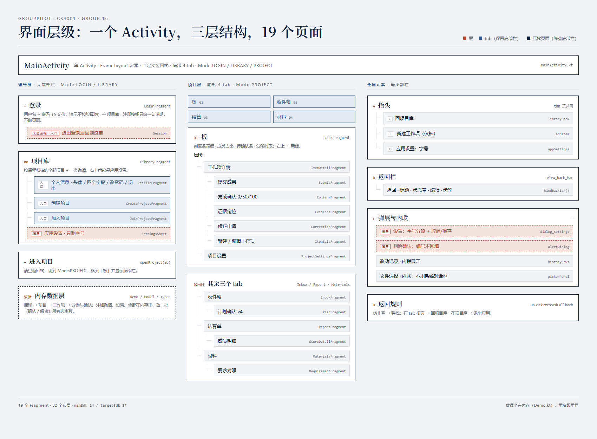

# GroupPilot · 界面功能与层级

> 一个 Activity、三层入口（登录 / 账号 / 项目）、19 个页面。这份文档说清楚：每页做什么、怎么到达、状态怎么锁、数据从哪来。
> 配套图：`docs/gui-hierarchy.png`（同目录 HTML 可再生成）。

---

## 0. 一句话

**登录 → 账号层选题（项目库）→ 项目层干活（板 / 收件箱 / 结算 / 材料）→ 子页处理一件具体的事。**

底部 4 个 tab 只在项目内出现；账号层与登录页都没有 tab，避免"选项目"和"做项目"两件事混在一个导航里。

---

## 1. 功能地图

| 层 | 页面 | 一句话职责 |
|---|---|---|
| 入口 | 登录 | 用户名 + 密码进项目库；注册按钮只给一句说明 |
| 账号层 | 项目库 | 按课程归档我参与的全部小组项目，外加一条待处理邀请 |
| 账号层 | 创建项目 | 选课程 → 起名 → 选模板 → 建组，立刻成为发起人 |
| 账号层 | 加入项目 | 输 6 位邀请码 → 看项目预览 → 加入 |
| 项目层 | 板 | 一屏回答：现在到哪了、谁在等我、我该点哪 |
| 项目层 | 收件箱 | 待确认 / 修正 / 计划变更的提醒列表（不代替结算） |
| 项目层 | 结算单 | 总分、成员占比、待确认提示、计算方式 |
| 项目层 | 材料 | 课程材料的解析状态，点进去看逐条要求 |
| 子页 | 工作项详情 | 一条工作项的全部证据：要求对照、证据、算式、操作 |
| 子页 | 提交成果 | 文件 / 链接 / 文字三种提交方式 |
| 子页 | 完成确认 | 0% / 50% / 100% 三档，实时预览会改什么 |
| 子页 | 证据定位 | 在材料原页上高亮被引用的那一段 |
| 子页 | 要求对照 | 材料里读出来的要求，逐条对照 |
| 子页 | 修正申请 | 对分摊 / 完成度 / 要求提异议，进入未决 |
| 子页 | 计划确认 | v4 的四项变更 + 变更后分摊，确认后生效 |
| 子页 | 成员明细 | 一个人的每一分怎么来的，逐条算式 |
| 子页 | 项目设置 | 邀请码、审批开关、成员移除、切换 / 退出项目 |
| 子页 | 新建 / 编辑工作项 | 一次填完一条工作项（含分摊百分比） |
| 账号 | 个人信息 | 头像（相册上传）、实名、账号名、电话、邮箱、`修改密码`（弹层）、退出登录 |
| 全局 | 应用设置 | 只剩字号 大 / 中 / 小 |

---

## 2. 逐页能做什么

### 2.0 登录

- 顶部：微标签 `GROUPPILOT · CS4001` + 32sp 衬线 `登录` + 一句 `用你的小组账号进入项目库。`
- 字段：`用户名`（下划线输入框，不放占位示例）、`密码`（圆点显示，占位 `至少 6 位`——这是规则不是示例，保留）
- 校验：空用户名 → 赭色 `请填用户名`；密码不足 6 位 → `密码至少 6 位（演示不校验真实密码）`；一开始打字就收掉旧提示
- 主按钮 `登录`：写入本机会话 + 把显示名改成这个用户名 → 淡入项目库（返回键退不回登录页）
- 次按钮 `注册账号`：不做页面，页脚那行临时变赭色——`注册还没开放：正式版会用课程邮箱验证，先随便填个用户名登录。`
- 下半页只留一句 `演示环境：不校验真实密码…`，没有其它说明块
- 再次打开 App：已登录 → 直接进项目库；只有"个人信息 → 退出登录"才会回到这里

### 2.1 项目库（账号层入口）

- 顶部：`[头像] wsq ›` ｜ `⚙ 设置` ｜ `2 门课程`（点左边这组进个人信息）
- 邀请条（赭色）：`迭代 3 · 可用性测试 / 周楚涵 邀请你 · SOFT3001 · 5 人`，点 `查看邀请` 直接进加入页并预填码
- 按课程分组：组头 `CS4001 · 人机交互 ——— 2026 秋`，下面是项目行
- 项目行：项目名 + `GROUP 16 · 4 人 · 计划 v3` + 右侧 `待确认 3`（发起人看到 `我创建`）
- 底部：`创建项目`（实心）/ `加入项目`（描边）
- 点项目行 → 进项目；点标题返回时不再回账号层（栈内只有项目页）

### 2.2 板

| 区域 | 交互 |
|---|---|
| 抬头 | `← 回项目库`、课号、`＋ 新建`、`⚙`、组号；标题是项目名，右下一行 `计划 v3` + `项目设置 ›` |
| 刻度条 | 4 格：待开始 / 进行中 / 待确认 / 已完成，数字是**项数**；点一格 = 筛选，再点取消 |
| 成员栏 | 4 个方形头像 + 名字 + 占比；顺序固定为加入顺序，**不按分数排** |
| 待你确认 · N | 4dp 靛蓝条，点整条 = 打开第一件待办 |
| 分段列表 | 按阶段分组，组头 `01 待开始 ——— 1 项`；行内：编号 / 标题 / `谁 · 几分 · 分摊` / 分数 / 状态章 |
| 行 | 点行 → 详情（编号做共享元素，340ms 转场） |

### 2.3 工作项详情

- 40sp 编号 + 标题 + `负责人 · 分值 · 分摊 [· 上次改动 谁 时间]`
- 分摊条 + 图例（自己 accent，别人 ink_40）
- 要求对照：`形式 / 位置 / 截止`，来源行只在材料解析出来的项上显示
- 成果证据：类型（文件/链接/文字）、标题、元信息、强度 3 格、`打开链接并定位`
- 计分行：`计入你的 4.0 分` + `8.0 × 50% × 100% = 4.0`；未确认时写"尚未确认"而不是 0.0
- 改动记录：`改动记录 N 条 ›` 内联展开，每行 `时间 · 谁 · 字段 旧 → 新`
- 底部主操作（一屏只给一个）：
  - 待确认且不是自己提交 → `确认完成`
  - 待确认且自己是提交人 → 禁用 `已提交 · 等待 X 确认`
  - 已完成 → `查看结算单`
  - 其他 → `提交成果`
- 右下 `编辑`：发起人或负责人，且未锁定时出现
- 页脚 `对分摊或完成度有异议？申请修正`

### 2.4 提交成果

- 三档分段：文件 / 链接 / 文字（选中档决定下方面板）
- 文件：虚线框 `选择文件` → **页内**文件列表（不用系统对话框），选中后显示 `名字 · 大小 · 修改时间`
- 链接：粘贴框 + 校验
- 文字：多行输入，最少 8 字
- 备注（可选）
- 页脚：`提交给 X 确认` + `提交后由 X 核对完成度，状态变为待确认`

### 2.5 完成确认

- 大分段 `0% 未达标 / 50% 部分达标 / 100% 达标`，默认停在该项当前值
- 实时算式 `8.0 × 100% = 8.0`，数字滚动 600ms
- **这一格确认后**：负责人积分 `4.0 → 8.0`、小组总分 `67.0 → 71.0`、待确认 `3 项 → 2 项`（不变的写 `不变`）
- 说明（选 0/50 时建议写原因）
- 固定页脚 `确认 · N%` + `确认人为非提交人 · 结果立即写入结算单`

### 2.6 结算单

- 总分 40sp + `已确认 7 / 12`（只算 100% 的）
- 构成条：4 段 accent 深浅，宽度 = 各自占比
- 成员行：`名字 · 你` / `X / Y 项已确认` / 积分 / 占比 / 占比条；**固定顺序，不排名**
- 赭色块：`3 项待确认 · 3 项等你` + `去处理`
- 计算方式：`个人积分 = Σ (基础分 × 完成度 × 分摊)`、`占比 = 个人积分 ÷ 小组总分`
- 页脚：`规则 v1.2 · 占比不等同于课程成绩`
- 点成员 → 成员明细

### 2.7 成员明细

- 44dp 头像 + 名字 + 40sp 积分 + `占比 28.1%`
- `计入明细`：每条 `编号 / 标题 / 分数 / 算式`
- `尚未计入`：赭色 `待确认 · 若 100% 则 6.0`
- 页脚 `快照 11-14 21:06 · 规则 v1.2` + `这一页只陈述计算过程，不做排名，也不给建议等级`

### 2.8 收件箱 / 材料 / 要求对照 / 证据定位 / 修正申请 / 计划确认 / 项目设置

- **收件箱**：`待确认`（08 / 09 / 11）与 `计划` 两类行，右侧相对时间；计划行赭色 → 计划确认
- **材料**：`项目简介.pdf 已解析`、`小组计划.docx 解析失败`（点开显示两条出路 + `重试解析`）；页脚 `材料只用于核对要求，不会自动改分数`
- **要求对照**：`作业 2 的要求`，逐组 `编号 标题` + 三行要求 + `第 N 页 原文` 引文
- **证据定位**：静态材料页 + 赭色半透明高亮框，框住被引用的 Submission 段落；页脚 `演示环境用静态页面示意`
- **修正申请**：`修正对象` 三段（分摊 / 完成度 / 要求对照）+ 说明 + 依据 + `处理流程 01/02/03`；提交后右上 `未决`、CTA 禁用
- **计划确认**：`计划 v4 · 由 何嘉俊 发起`，4 条 `+ 新增 / ~ 改分值 / − 移除`，`变更后分摊`，`确认计划 v4`
- **项目设置**：邀请码（发起人可见）+ 复制 / 重新生成、`加入需要我确认` 开关、成员列表（移除）、切换 / 退出项目；成员视角只看到成员与一行说明

---

## 3. 状态与权限（同一页面的三种形态）

| 触发条件 | 谁受影响 | 表现 |
|---|---|---|
| 未登录 | 所有人 | 只有登录页，没有 tab、没有返回栈；返回键退出应用 |
| 已登录 | 所有人 | 项目库；右上齿轮或任意返回栏都能进设置（只有字号）；退出登录在「个人信息」 |
| 工作项已完成 / 已 100% 确认 | 所有人 | 详情无 `编辑`；直接进编辑页则全置灰、CTA `已确认 · 不可修改` |
| 工作项待确认 | 所有人 | 编辑页只放开标题 / 位置 / 截止 / 说明；分值、分摊、负责人、阶段置灰 |
| 不是发起人也不是负责人 | 该成员 | 分值 / 分摊置灰、CTA 禁用，提示走修正申请 |
| 项目成员（非发起人） | 项目设置 | 看不到邀请码与审批开关，只看到成员 + 说明 |
| 尚未提交证据 | 负责人 | 详情证据区显示空态；删除按钮可用（编号不回填） |

结算只吃 `accepted >= 100` 的项；50% 计入分数但不算"已确认"，所以顶部计数和总分会分开动。

---

## 4. 数据从哪来

```
AppSettings（字号）      Profile（头像 / 实名 / 账号名 / 电话 / 邮箱 / 密码）      Session（已登录 + 用户名）
        │                              │
Demo ───┼── courses: [CS4001, COMP3009, SOFT3001]
        ├── projects: [交互设计大作业, 可用性测试试点, 图书借阅系统课程设计]
        ├── invitations: [周楚涵 的 R3F8K2]
        ├── expiredCodes: [X9T2W5]
        └── current: Project?
                 ├── members: [何嘉俊, 王舜祺, 陈实, 李文豪]
                 ├── items: [w01…w12]，每条 points / accepted / shares / evidence / reqs / history
                 └── planVersion, inviteCode, requireApproval, role
```

- 全部在内存，**重启即重置**（演示需要）
- 任何写操作（确认 / 编辑 / 提交 / 加入 / 建项）都会 `Demo.bump()`，页面 `onResume` 比对版本号重绘
- 分数不存"结果"，只存 `points × accepted × shares`，每次现算 —— 所以公式行永远和数字一致

---

## 5. 层级图



同一张图的文字版：

```
MainActivity（单 Activity · Fragment 容器 · 自定义栈 · 底部 4 tab）
│
├─ Mode.LOGIN（无底部栏 · 未登录唯一入口）
│   └─ LoginFragment 登录
│
├─ Mode.LIBRARY（无底部栏）
│   └─ LibraryFragment 项目库
│       ├─ ProfileFragment        个人信息（头像 / 实名 / 账号 / 电话 / 邮箱 / 密码 / 退出）
│       ├─ CreateProjectFragment  创建项目
│       └─ JoinProjectFragment    加入项目
│   └─ SettingsSheet（弹层）      应用设置（只有字号）
│
└─ Mode.PROJECT（显示底部栏）
    ├─ 板 BoardFragment
    │   ├─ ItemDetailFragment 工作项详情
    │   │   ├─ SubmitFragment        提交成果
    │   │   ├─ ConfirmFragment       完成确认
    │   │   ├─ EvidenceFragment      证据定位
    │   │   ├─ CorrectionFragment    修正申请
    │   │   └─ ItemEditFragment      新建 / 编辑
    │   └─ ProjectSettingsFragment 项目设置
    ├─ 收件箱 InboxFragment ── PlanFragment 计划确认
    ├─ 结算单 ReportFragment ── ScoreDetailFragment 成员明细
    └─ 材料 MaterialsFragment ── RequirementFragment 要求对照
```

**返回规则**：栈非空 → 弹栈；在 tab 根页 → 回项目库；在项目库 → 退出应用。

---

## 6. 实现要点

- 导航：`Fragment.push(target, sharedView?, sharedName?)`，`replace(R.id.container)` + `addToBackStack`；`setTabsVisible()` 控制底部栏
- 登录：`Session`（SharedPreferences `gp_session`）只存"是否登录 + 用户名"，启动时决定进登录页还是项目库；退出登录 = 清会话 + `recreate()`，重建时若未登录则强制回登录页
- 转场：列表行 → 详情用 `MaterialContainerTransform`（340ms，编号做 transitionName），其余用 200ms 标准曲线
- 资料：`Profile`（SharedPreferences `gp_profile`）存头像路径 / 实名 / 账号名 / 电话 / 邮箱 / 密码；头像用 `PickVisualMedia` 选图、缩到 512px 存私有目录，显示时按 26% 圆角裁切
- 字号：`AppSettings.fontScale` 写进 `Configuration`，改档位时 `recreate()`；所有尺寸走 `sp`，小标签用 `letterSpacing`
- 视觉：24dp 边距、1dp 细线、直角；标题与数字用衬线（`serif` = Noto Serif CJK），正文与数据用无衬线，数字 `tnum`
- 颜色：`paper/ink/accent/ochre/line/muted` 六个值，赭色只用于"待确认 / 异常 / 偏差"
